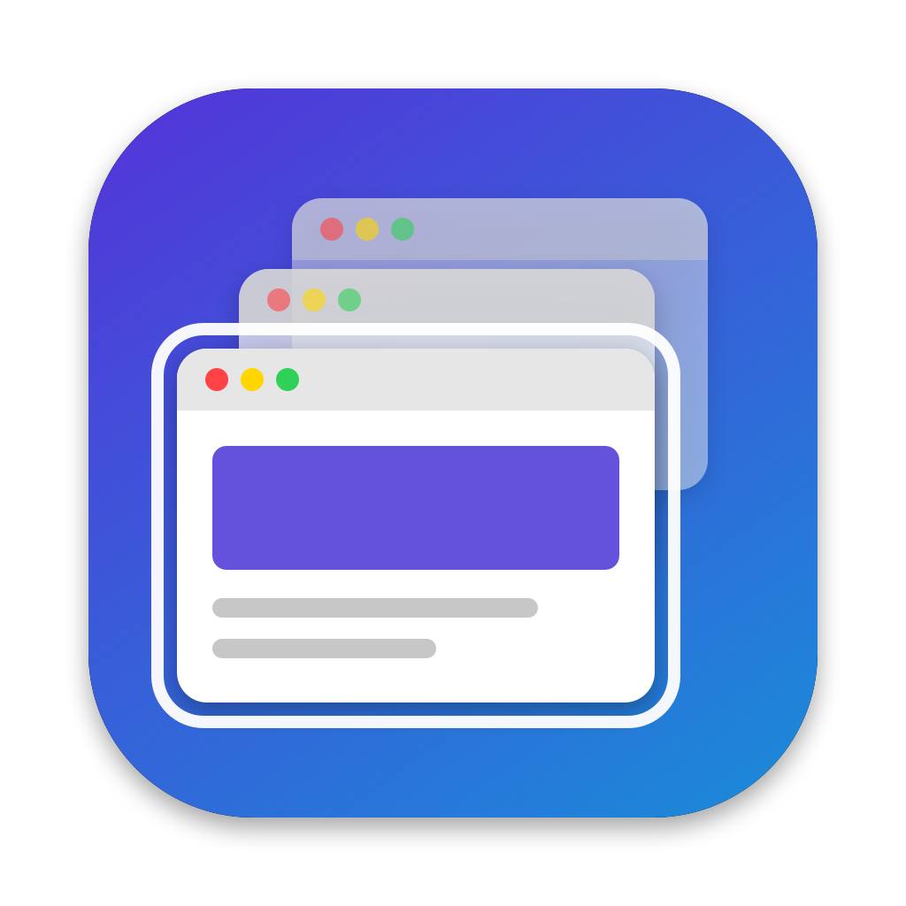
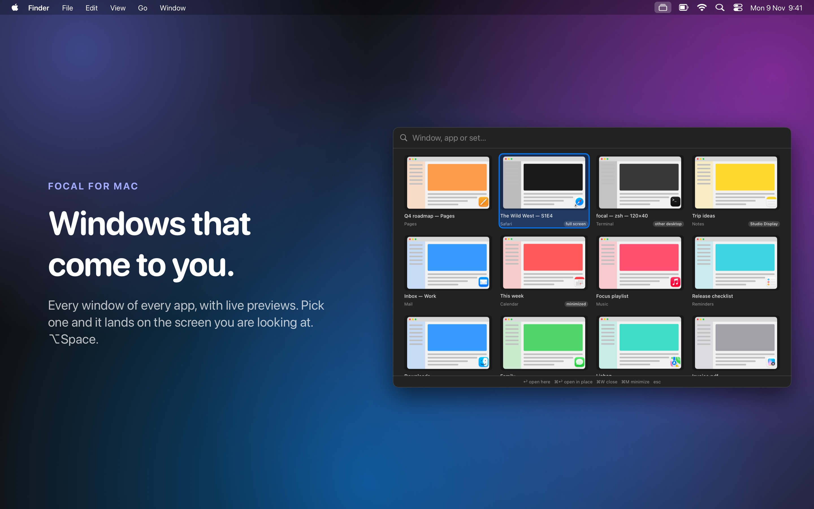
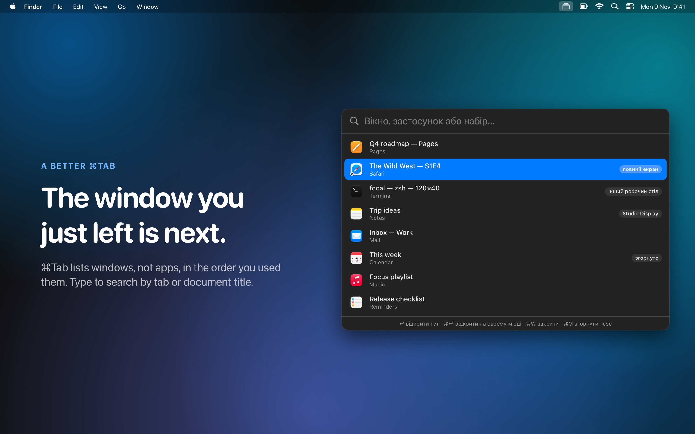
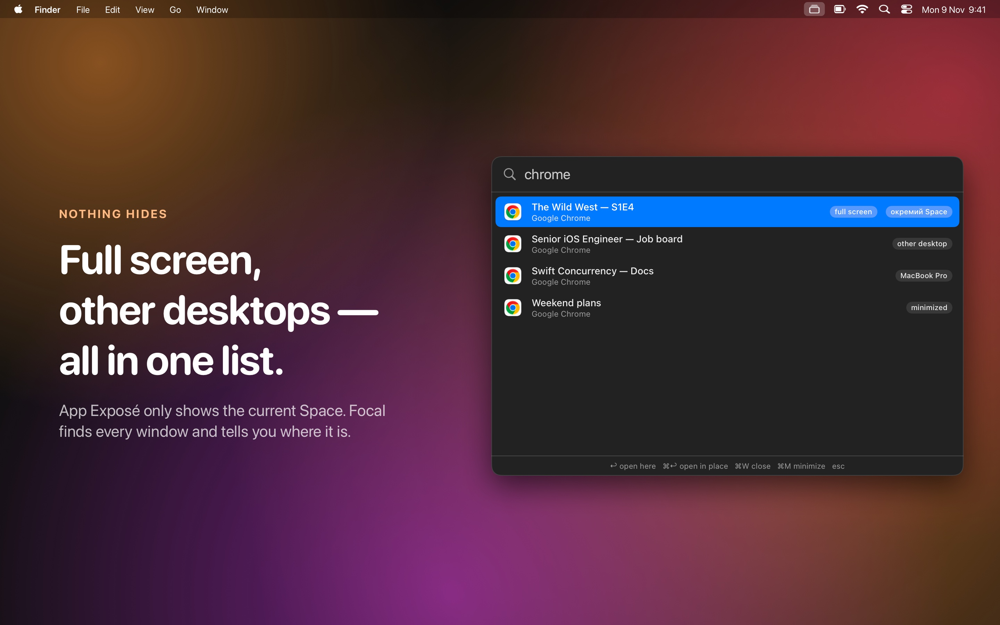
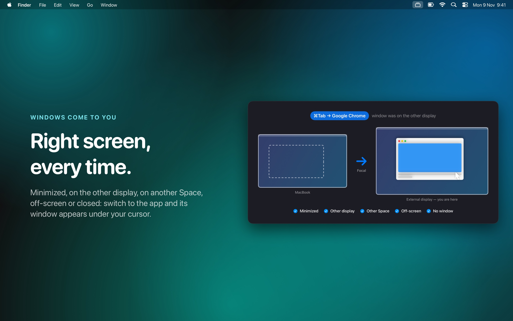
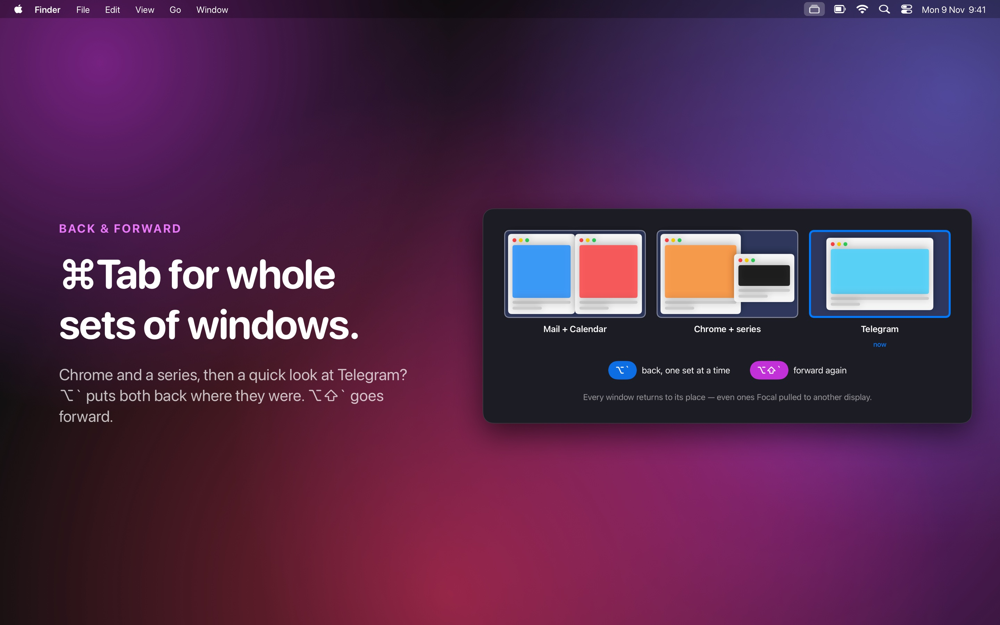
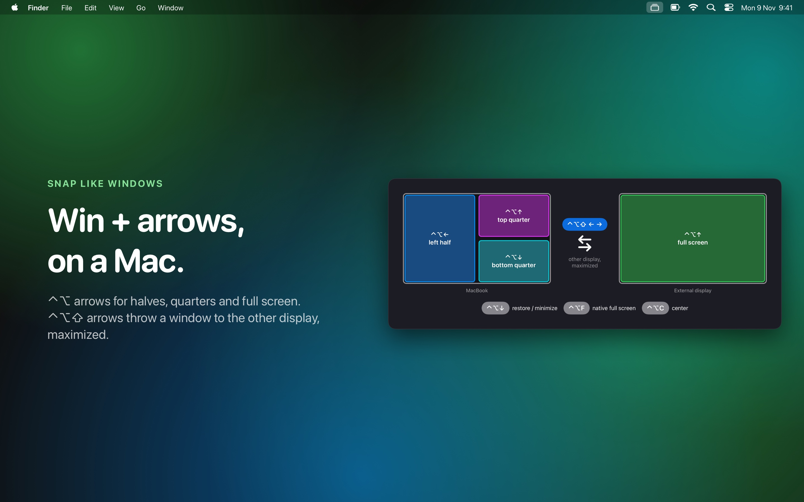
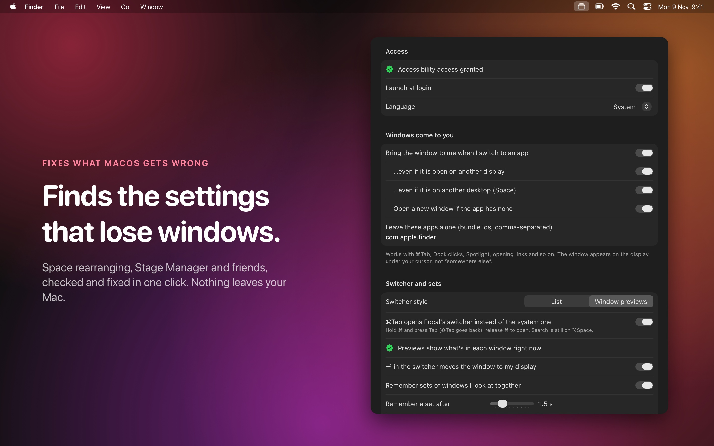

<p align="center">
  
</p>

<h1 align="center">Focal</h1>

<p align="center"><b>Windows that come to you.</b><br>
A menu bar window manager for macOS that fixes everything ⌘Tab gets wrong.</p>

<p align="center"></p>

macOS thinks in apps, not windows. ⌘Tab activates Chrome, but its window is minimized, on the other display, on another desktop or in full screen, so you see nothing. Focal makes every switch land: the window appears on the screen you are looking at, ⌘Tab lists windows in the order you used them, and ⌥\` brings back the whole set of windows you were just working with.

## Why Focal

- **The window shows up where you are.** Switch to an app with ⌘Tab, the Dock or Spotlight, and its window is un-minimized, pulled from the other display, Space or off-screen, or reopened, right under your cursor.
- **A ⌘Tab that knows windows.** Every window of every app, in most-recently-used order, so the one you just left is always next. Live previews or a compact list, with search by tab or document title.
- **Nothing hides.** Full-screen windows and windows on other desktops are listed too, labelled with where they are. App Exposé can't do that.
- **Back and forward for your workspace.** Focal remembers which windows you looked at together. ⌥\` puts the previous set back exactly where it was, ⌥⇧\` goes forward.
- **Snap like Windows.** ⌃⌥ arrows for halves, quarters and full screen; ⌃⌥⇧ arrows throw a window to the other display, maximized.
- **Fixes macOS.** Detects the settings that make windows "move" (Space rearranging, Stage Manager) and fixes them in one click.
- **Private and native.** Swift and SwiftUI, a few MB, no network, no account.

| | |
| --- | --- |
|  |  |
|  |  |
|  |  |

Raw panel renders are in [docs/screenshots](docs/screenshots). Launch copy is in [docs/marketing/launch-kit.md](docs/marketing/launch-kit.md). The app's interface is in Ukrainian for now.

## Why windows get lost on a Mac

| Situation | What macOS does | What you see |
| --- | --- | --- |
| Window on the other display | activates it there | nothing, you are looking at the other screen |
| Window minimized | ⌘Tab does **not** restore it | nothing |
| Window on another Space | jumps you to that Space, or does nothing | a jump, or nothing |
| Window in full screen | it is its own Space; App Exposé says "No Available Windows" | "Chrome has two windows but I only see one" |
| App has no windows | activates the menu bar only | an empty screen |
| Window left on a disconnected display's coordinates | nothing | the window is off-screen |
| "Automatically rearrange Spaces" (on by default) | reorders desktops by recent use | windows seem to move around |

App Exposé, the Dock menu and the Accessibility API only report windows on the Spaces currently shown. Focal finds the rest directly, in the background so ⌘Tab never waits, and labels them.

## What's inside

**Windows come to you**
- On every app switch (⌘Tab, Dock, Spotlight, links), if nothing of that app is visible where you are, Focal un-minimizes, moves or reopens its window on the display under the cursor and raises it.
- Pulls windows from the other display, from other Spaces (minimize-and-restore round trip) and from off-screen coordinates; reopens apps that have no windows, like a Dock click.
- Never drops a window onto a display that shows a full-screen app; it uses the other display instead.
- Per-option toggles and an ignore list (Finder is ignored by default). ⌥⇧Space pulls the frontmost app's window to you on demand.

**Switcher (⌘Tab and ⌥Space)**
- Replaces the system ⌘Tab: hold ⌘, press Tab / ⇧Tab, release ⌘ to open. A quick ⌘Tab goes back to the previous window. Can be turned off.
- Lists windows in most-recently-used order, including full-screen windows, other desktops, minimized windows and menu bar apps that have windows (Docker Desktop and friends).
- Two styles: live window previews (ScreenCaptureKit) or a compact list. Badges show full screen, other desktop, other display or minimized.
- Fuzzy search by window title, tab or document name and app name (including the name Finder shows, so "vs code" finds Visual Studio Code). Apps that aren't running show up too and launch on ↩. ↩ brings the window to your display, ⌘↩ opens it where it is, ⌘W closes, ⌘M minimizes.
- Also lists recent window sets, saved layouts and running apps without windows.

**Window sets: back and forward**
- Focal notices which windows you actually look at together (only the visible ones, not those buried underneath).
- ⌥\` steps back through those sets, ⌥⇧\` steps forward; each set returns with its windows in their places. Windows Focal pulled to another display go back where they came from.
- Save a set with ⌃⌥S and restore it with ⌃⌥1…9: missing apps are launched, windows reopened and placed.

**Snapping**
- ⌃⌥←/→ halves; press again to continue onto the neighbouring display. ⌃⌥↑ maximize (from a half: top quarter), ⌃⌥↓ restore (from a half: bottom quarter; otherwise minimize).
- ⌃⌥⇧←/→ moves to the display on the left or right and maximizes there. ⌃⌥F native full screen, ⌃⌥C center, ⌃⌥⌫ size before snapping.
- Frames are verified after each move because apps clamp their size to the old display a moment later.

**macOS check-up**
- Shows Space rearranging, "switch to a Space with open windows", Stage Manager and per-display Spaces, with a one-click fix where it helps.

## Keyboard

| Key | Action |
| --- | --- |
| ⌘Tab / ⌘⇧Tab | Switcher, next / previous window (release ⌘ to open) |
| ⌥Space | Switcher with search |
| ⌥\` / ⌥⇧\` | Previous / next window set |
| ⌥⇧Space | Bring the frontmost app's window to this display |
| ⌃⌥← → ↑ ↓ | Halves, quarters, maximize, restore |
| ⌃⌥⇧← → | Move to the display on the left / right |
| ⌃⌥↩ · ⌃⌥⌫ · ⌃⌥F · ⌃⌥C | Fill · previous size · full screen · center |
| ⌃⌥S · ⌃⌥1…9 | Save the current set · restore a saved set |

Inside the switcher: ↑ ↓ (and ← → in the grid) move, ↩ opens here, ⌘↩ opens in place, ⌘W closes, ⌘M minimizes, esc closes.

## Build and install

Requires Xcode or the Command Line Tools (Swift 5.10+) and macOS 14 or later.

```bash
scripts/build.sh --install
```

Builds `build/Focal.app`, copies it to `~/Applications` and launches it. It is signed with your Apple Development certificate when one is available, so the Accessibility permission survives rebuilds.

Focal needs **Accessibility** to move other apps' windows (System Settings → Privacy & Security → Accessibility). Live previews also need **Screen Recording**; without it the grid shows app icons. Launch at login is in Focal's settings.

## Tests and checks

Focal can be driven from the shell, Shortcuts or Raycast:

```bash
open -g "focal://switcher"            # show / hide the switcher
open -g "focal://back"                # previous window set
open -g "focal://forward"             # next window set
open -g "focal://summon"              # bring the frontmost window here
open -g "focal://snap?to=left"        # left right up down maximize center restore fullscreen displayLeft displayRight
open -g "focal://save?name=Work"      # save the visible windows as a layout
open -g "focal://layout?n=1"          # restore layout 1
open -g "focal://focus?id=123"        # raise a window by id
open -g "focal://dump"                # Focal's view of all windows → state.json
open -g "focal://inspect?app=com.google.Chrome"   # everything macOS reports about one app → inspect.json
```

Debug output goes to `~/Library/Application Support/Focal/`. `defaults write dev.focal.app debugScreen -int N` pins "the display I am on" to screen N, which makes multi-display scenarios scriptable.

Screenshots and promo images are rendered from demo data, never from your real windows:

```bash
open -g "focal://render-docs?dir=/tmp/focal-docs"
```

```bash
swift scripts/make-promo.swift /tmp/focal-docs/snapshots docs/promo
```

The icon is drawn by `swift scripts/make-icon.swift Resources/AppIcon.png`.

## Layout

```
Sources/Focal/AX.swift            Accessibility wrapper, windows on other Spaces via remote AX tokens
Sources/Focal/Windows.swift       window list, what is actually visible, MRU ordering
Sources/Focal/Recency.swift       which window was focused when
Sources/Focal/AutoSummon.swift    reaction to app switches
Sources/Focal/Actions.swift       raise, move, pull from other Spaces, restore sets
Sources/Focal/Contexts.swift      window-set history and back / forward
Sources/Focal/Layouts.swift       saved sets
Sources/Focal/Switcher.swift      ⌘Tab / ⌥Space panel (list and grid)
Sources/Focal/CommandTab.swift    takes ⌘Tab from the system switcher and gives it back on quit
Sources/Focal/Snap.swift          Windows-style snapping
Sources/Focal/SettingsView.swift  settings and the macOS check-up
Sources/Focal/DocsRender.swift    demo renders for docs; PromoArt.swift holds the illustrations
scripts/                          build, icon and promo generators
```

## Limitations

- macOS has no public API to move a window between Spaces, so Focal minimizes and restores it, which shows a short animation.
- Full-screen windows cannot be moved; Focal switches to their Space instead.
- Taking over ⌘Tab uses a private CoreGraphics call. Focal gives ⌘Tab back when it quits; after a crash it comes back on the next launch or log-in.
