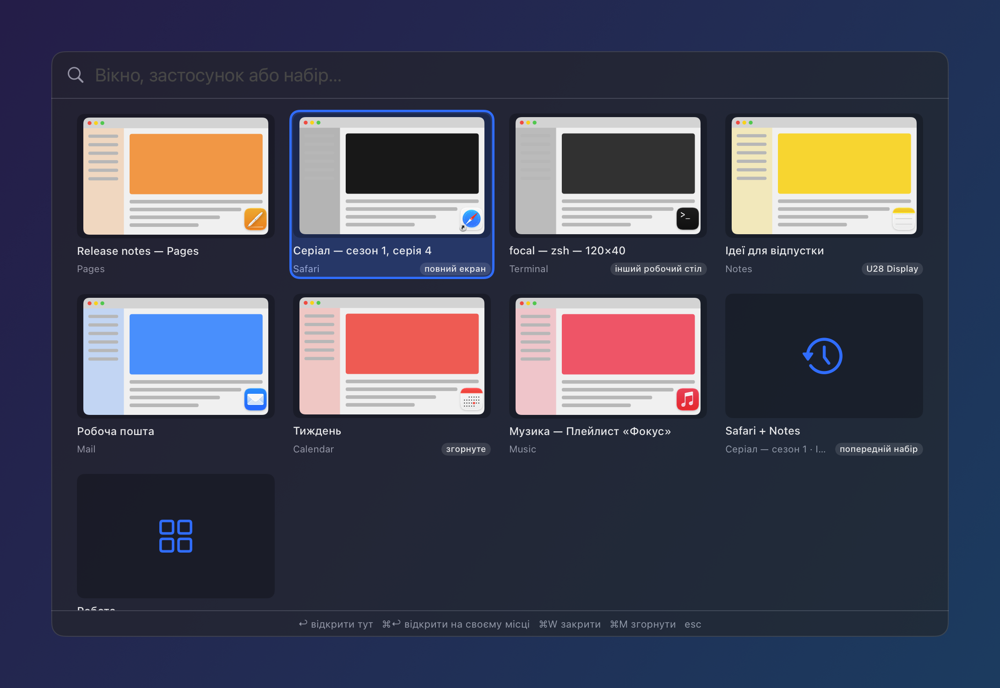
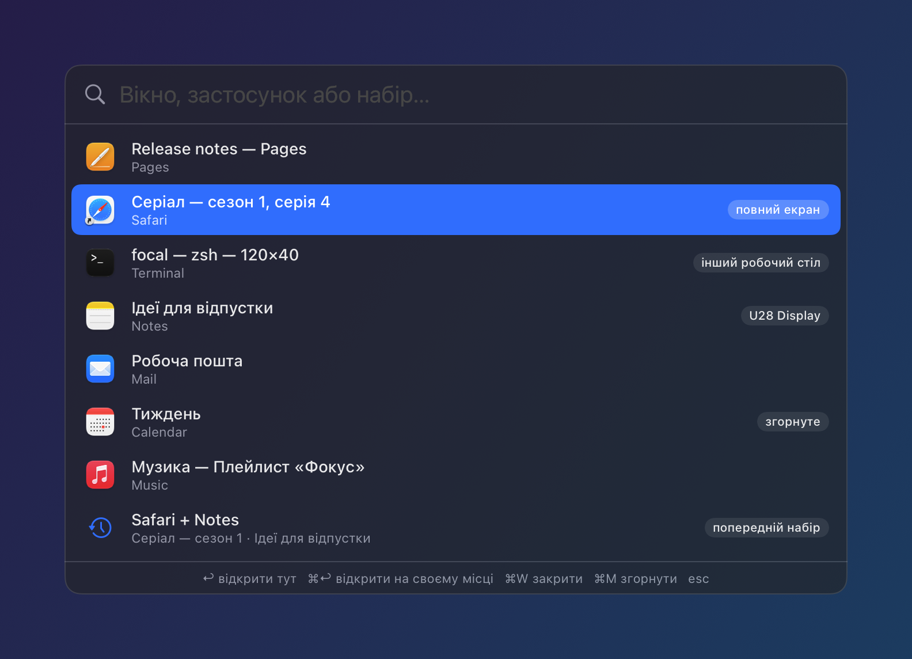
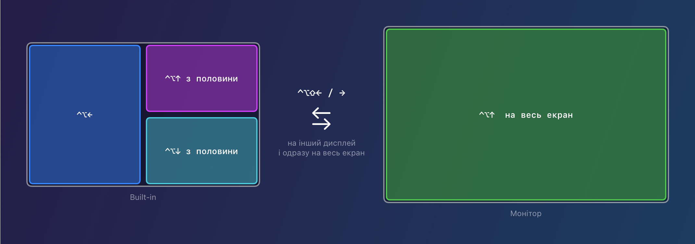
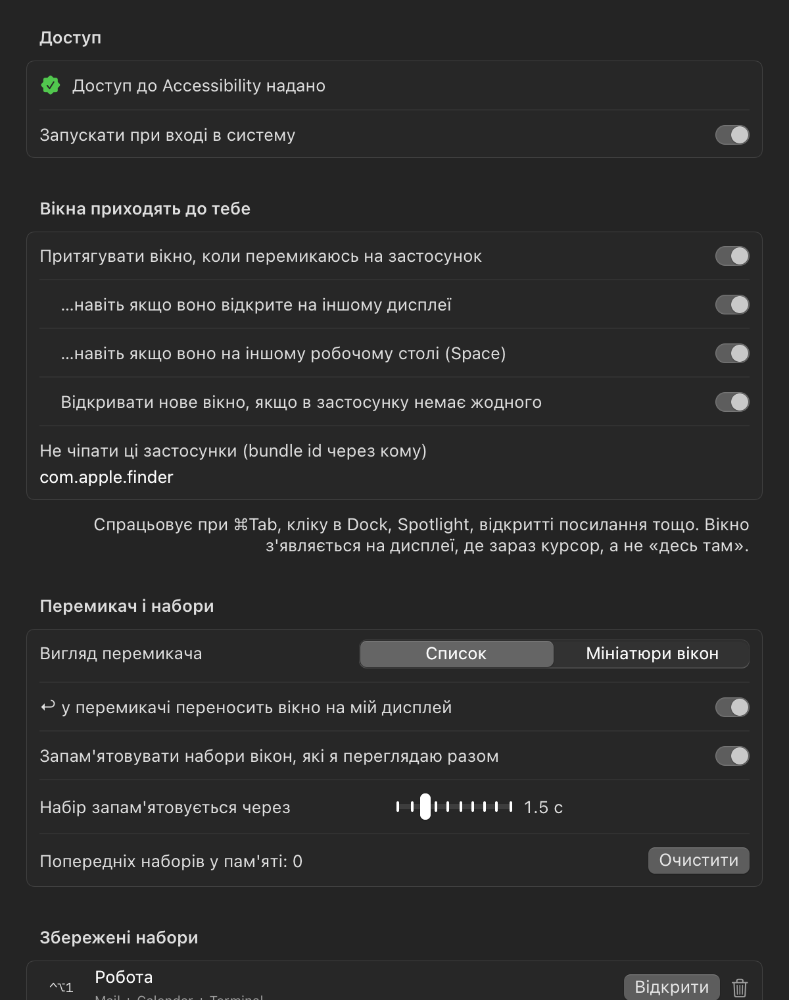

<p align="center"></p>

<h1 align="center">Focal — вікна, які приходять до тебе</h1>

<p align="center"></p>

Маленький застосунок у рядку меню macOS, який прибирає головний біль із вікнами:
застосунок «відкрився», а вікна не видно, бо воно згорнуте, на іншому моніторі,
на іншому робочому столі (Space) або його взагалі немає.

## Чому на Mac вікна «губляться»

macOS думає **застосунками**, а не **вікнами**. ⌘Tab активує застосунок, але
не гарантує, що ти побачиш його вікно:

| Ситуація | Що робить macOS | Що бачиш ти |
|---|---|---|
| Вікно на другому дисплеї | активує його там | нічого: ти дивишся на інший екран |
| Вікно згорнуте в Dock | ⌘Tab його **не** розгортає | нічого |
| Вікно на іншому Space | перекидає тебе на той Space (або нічого, якщо це вимкнено) | «стрибок» або нічого |
| У застосунку немає вікон (Chrome без вікон) | просто активує меню | порожній екран |
| Вікно лишилось на координатах відключеного монітора | нічого | вікно «за межами» |
| «Автоматично переставляти Spaces» увімкнено (за замовчуванням) | сам міняє порядок робочих столів | вікна «переїжджають» |
| Вікно в повноекранному режимі | це окремий Space; App Exposé на робочому столі пише «No Available Windows» | «у Chrome два вікна, а видно одне» |

**Чому App Exposé і Dock показують не всі вікна Chrome.** macOS (і Accessibility API)
показує вікна лише з робочих столів, які зараз на екрані. Повноекранне вікно живе
на окремому Space, а кожен дисплей має власні робочі столи, тож вікно, відкрите на
іншому робочому столі другого монітора, «зникає». Меню Chrome «Вікно» знає про всі
вікна, бо це власний список Chrome. Focal знаходить такі вікна напряму (~30 мс на
застосунок) і показує їх з позначками «інший робочий стіл» / «повний екран».

Плюс у macOS немає поняття «набір вікон, з якими я зараз працюю»: якщо в тебе
Chrome + серіал, ти переходиш у Telegram і повертаєшся, ⌘Tab поверне тільки
один застосунок.

## Що робить Focal

1. **Вікна приходять до тебе.** Коли ти перемикаєшся на застосунок (⌘Tab, Dock,
   Spotlight, посилання), а його вікна на твоєму дисплеї не видно, Focal сам
   розгортає вікно, переносить його з іншого дисплея / Space / з-за меж екрана
   на дисплей під курсором і піднімає нагору. Якщо вікон немає взагалі, Focal
   відкриває нове (як клік у Dock). Finder за замовчуванням не чіпається.
2. **Перемикач `⌥Space`.** Усі вікна всіх застосунків (з усіх робочих столів і
   повноекранних) з пошуком за назвою вкладки/документа і застосунку, з
   позначками «згорнуте», «інший дисплей», «інший робочий стіл», «повний екран».
   `↩` відкриває вікно на твоєму дисплеї, `⌘↩` на його місці, `⌘W` закриває,
   `⌘M` згортає. Два вигляди (Налаштування → «Вигляд перемикача»):

   | Список | Мініатюри вікон |
   |---|---|
   |  |  |

   Мініатюри показують, що зараз у вікні; для цього потрібен дозвіл «Запис екрана»
   (без нього — іконки застосунків). У сітці стрілки ходять у всі боки.
3. **Назад і вперед по наборах вікон `⌥`` / `⌥⇧``.** Focal запам'ятовує, які
   вікна ти реально бачив разом (наприклад Chrome + серіал). `⌥`` повертає
   попередній набір на свої місця (кожне натискання — ще крок назад), `⌥⇧``
   веде вперед, аж до поточного. Як «Назад/Вперед» у браузері, тільки для вікон.
   Вікна, які Focal притягнув до тебе, при поверненні їдуть назад.
4. **Збережені набори `⌃⌥S` / `⌃⌥1…9`.** Розклади вікна як треба, збережи
   («Робота», «Серіал»). Відновлення запустить потрібні застосунки, відкриє
   вікна, розставить їх по місцях і підніме.
5. **`⌥⇧Space`** притягує вікно активного застосунку на твій дисплей.
<p align="center"></p>

6. **Керування активним вікном, як Win + стрілки у Windows** (на Mac це `⌃⌥`,
   бо `⌘+стрілки` — це рух по тексту, а `⌥⌘+стрілки` перемикають вкладки):

   | Клавіші | Дія |
   |---|---|
   | `⌃⌥←` / `⌃⌥→` | ліва / права половина; ще раз у той самий бік — на сусідній дисплей; у протилежний — повернути розмір |
   | `⌃⌥↑` | розгорнути на весь екран; з половини — верхня чверть |
   | `⌃⌥↓` | з розгорнутого — попередній розмір; з половини — нижня чверть; інакше згорнути |
   | `⌃⌥⇧←` / `⌃⌥⇧→` | перекинути на дисплей ліворуч / праворуч і одразу розгорнути під нього (вимикається в налаштуваннях) |
   | `⌃⌥↩` | заповнити екран |
   | `⌃⌥⌫` | повернути розмір, що був до прилипання |
   | `⌃⌥F` | справжній повноекранний режим macOS |
   | `⌃⌥C` | по центру |
7. **Діагностика налаштувань macOS**, які заважають (автоперестановка Spaces,
   Stage Manager тощо), з кнопкою виправлення.

<p align="center"></p>

## Керування з Shortcuts / Raycast / терміналу

```bash
open -g "focal://switcher"      # показати/сховати перемикач
open -g "focal://back"          # попередній набір вікон
open -g "focal://forward"       # наступний набір вікон
open -g "focal://summon"        # притягнути активне вікно сюди
open -g "focal://save?name=Робота"
open -g "focal://layout?n=1"    # відновити набір №1
open -g "focal://focus?id=123"  # підняти вікно за id
open -g "focal://snap?to=left"  # left right up down maximize center restore fullscreen displayLeft displayRight
open -g "focal://dump"          # стан у ~/Library/Application Support/Focal/state.json
open -g "focal://inspect?app=com.google.Chrome"  # усе про вікна застосунку → inspect.json
open -g "focal://render-docs?dir=$PWD/docs"      # перемалювати скріншоти README (демо-дані)
```

## Встановлення

```bash
scripts/build.sh --install
```

Збирає `build/Focal.app`, копіює в `~/Applications` і запускає. Потрібні Xcode
або Command Line Tools (Swift 5.10+), macOS 14+.

При першому запуску macOS попросить доступ **Accessibility** (Системні
параметри → Конфіденційність і безпека → Доступність → увімкнути Focal). Без
нього Focal не може рухати чужі вікна. Збірка підписується твоїм Apple
Development сертифікатом, тож доступ не злітає після перезбирання.

Автозапуск: Налаштування Focal → «Запускати при вході в систему».

## Як це влаштовано

- `Sources/Focal/AX.swift`: Accessibility API (позиції, згортання, підняття
  вікон). Для вікон на інших Spaces використовується той самий прийом, що й в
  alt-tab-macos (`_AXUIElementCreateWithRemoteToken`).
- `Windows.swift`: список вікон з WindowServer і розрахунок, які вікна реально
  видно (а не перекриті іншими).
- `AutoSummon.swift`: реакція на перемикання застосунків.
- `Contexts.swift`: історія наборів вікон і `⌥``.
- `Layouts.swift`: збережені набори.
- `Switcher.swift`, `Thumbnails.swift`: перемикач `⌥Space` (список і мініатюри через ScreenCaptureKit).
- `Snap.swift`: керування активним вікном.
- `DocsRender.swift`, `scripts/make-icon.swift`: скріншоти для README та іконка.
- `SettingsView.swift`, `App.swift`: налаштування, меню, гарячі клавіші.

Дані лежать у `~/Library/Application Support/Focal/`.

## Обмеження

- Переносити вікно між Spaces публічним API macOS не дозволяє, тому Focal
  робить «згорнути → розгорнути»: розгорнуте вікно з'являється на поточному Space.
  Через це видно коротку анімацію.
- Повноекранні вікна (окремий Space) не переносяться: Focal на них просто перемикає.
- Якщо на дисплеї, де ти зараз, відкритий повноекранний застосунок, звичайне вікно
  туди не поставиш (воно опиниться на прихованому робочому столі). Тому Focal
  притягує вікно на інший дисплей, а якщо обидва в повному екрані, лишає це macOS.
- Гарячі клавіші поки фіксовані; якщо якусь займає інша програма, Focal
  покаже це в налаштуваннях.
